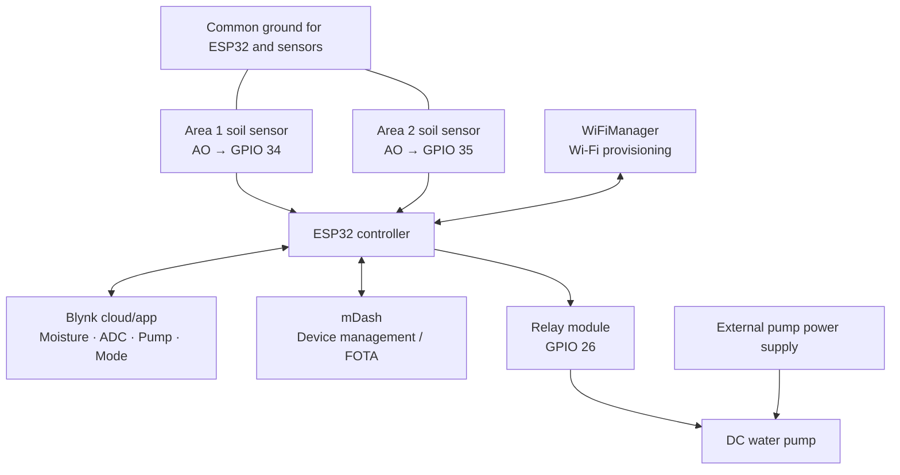
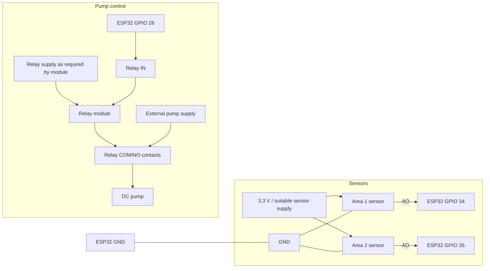

# ESP32 Smart Water Irrigation System

An ESP32-based IoT irrigation controller for monitoring **two separate soil areas** and controlling one shared water pump. It combines Wi-Fi provisioning with WiFiManager, remote monitoring and control through Blynk, and remote device management through mDash.

> **Current setup:** two analog soil-moisture sensors (GPIO 34 and 35) and one relay-controlled pump (GPIO 26). Because both areas share one pump, automatic watering starts when either area is dry and stops only when both areas reach the configured moisture target.


## System architecture diagram

The ESP32 reads both soil-moisture sensors, applies the AUTO/MANUAL logic, and controls one shared pump through the relay. Readings and controls are exposed through Blynk; Wi-Fi is provisioned with WiFiManager and device management uses mDash.



## Wiring diagram



> **Wiring note:** The diagram is a functional overview, not a pin-by-pin relay terminal drawing. Use the relay module's documented VCC/GND/IN pins and COM/NO/NC markings. Keep the pump on its correctly rated external supply; never power it from an ESP32 GPIO. Ensure sensor output voltage stays within ESP32 input limits. Share ground where required by the sensor/driver design.

## Features

- Wi-Fi setup through WiFiManager; no Wi-Fi credentials hard-coded in the firmware
- Two soil-moisture sensors sampled and reported separately
- 100 ADC samples per measurement, collected without a long blocking delay
- Blynk dashboard readings for moisture, raw ADC values, pump status, and control mode
- Manual pump control and automatic irrigation mode
- Separate start/stop moisture thresholds (hysteresis) to reduce relay chatter
- mDash device management and firmware-update integration
- Built-in Mongoose TLS configuration
- Local secrets file excluded from Git

## Hardware

### Required for the current build

- ESP32 Dev Module
- 2 analog soil-moisture sensors compatible with the ESP32's 3.3 V logic
- 1 relay module or appropriately rated MOSFET driver
- 1 DC water pump
- External power supply suitable for the pump
- Tubing and connecting wires
- USB cable/power supply for the ESP32

### Wiring

| Component | ESP32 connection | Notes |
|---|---|---|
| Area 1 moisture sensor AO | GPIO 34 | Analog input |
| Area 2 moisture sensor AO | GPIO 35 | Analog input |
| Both sensor VCC | Suitable sensor supply | Use 3.3 V when required by the sensor; keep output within ESP32 ADC limits |
| Both sensor GND | ESP32 GND | Common ground for sensor readings |
| Relay control input | GPIO 26 | Firmware defaults to active-LOW relay logic |
| Relay/pump contacts | Pump supply circuit | Follow the relay module ratings and pump supply requirements |

**Safety:** Never power the pump from an ESP32 GPIO. Switch the pump using a correctly rated relay/driver and an appropriate external supply. Check the relay's active level before connecting the pump. Do not apply 5 V to an ESP32 GPIO or ADC input.

## Pin configuration

| GPIO | Function |
|---:|---|
| 34 | Area 1 soil-moisture analog input |
| 35 | Area 2 soil-moisture analog input |
| 26 | Pump relay control |

The firmware uses 12-bit ADC readings and `ADC_11db` attenuation. ADC values and moisture percentages depend on the sensor and the soil; calibrate each sensor independently.

## Blynk setup

Create a Blynk template/device and add datastreams matching these virtual pins:

| Virtual pin | Function | Suggested data type |
|---|---|---|
| V0 | Area 1 moisture (%) | Double |
| V3 | Pump status (0 = OFF, 1 = ON) | Integer |
| V4 | Manual pump command (0 = OFF, 1 = ON) | Integer |
| V5 | Mode (0 = MANUAL, 1 = AUTO) | Integer |
| V6 | Area 1 raw ADC average | Integer |
| V7 | Area 2 moisture (%) | Double |
| V8 | Area 2 raw ADC average | Integer |

Suggested widgets:
- Gauges or value displays for V0 and V7
- Value displays for V6 and V8 when calibrating
- Switch for V4
- Switch for V5
- LED/value display for V3

The firmware restores V4 and V5 from Blynk when it reconnects. Manual pump commands are ignored while AUTO mode is active.

## Automatic irrigation behavior

Default settings in `ESP32-Irrigation.ino`:

```cpp
#define PUMP_ON_THRESHOLD  30
#define PUMP_OFF_THRESHOLD 60
```

The firmware calculates moisture as a percentage from each sensor's dry and wet ADC calibration values. With the default calibration, a higher ADC reading means drier soil and a lower reading means wetter soil.

- **Pump starts:** when AUTO mode is enabled, the pump is OFF, and either area reads at or below 30%.
- **Pump stops:** when the pump is ON and both areas read at or above 60%.
- **MANUAL mode:** V4 controls the pump directly.
- **Startup:** the pump is initialized OFF.

These thresholds are starting values; tune them for your sensors, soil, and plants. With one shared pump, this logic cannot water each area independently. Independent watering requires a separate pump or a separately controlled valve for each area.

## Sensor calibration

The firmware currently defines these starting values:

```cpp
#define SOIL1_DRY_ADC 1103
#define SOIL1_WET_ADC 1030
#define SOIL2_DRY_ADC 1103
#define SOIL2_WET_ADC 1030
```

Sensor 1's values are based on initial readings. Sensor 2's values are placeholders and must be measured independently.

1. Upload the firmware and open Serial Monitor at **115200 baud**.
2. Record the raw ADC value for each sensor in dry soil/air as appropriate for your intended calibration method.
3. Record the raw ADC value for each sensor in thoroughly wet soil.
4. Update that sensor's `DRY_ADC` and `WET_ADC` constants.
5. Confirm that the reported percentage rises as the soil gets wetter before enabling automatic mode.

The firmware averages 100 samples per measurement. Calibration readings can vary with sensor type, supply voltage, soil composition, and sensor aging.

## Software requirements

- Arduino IDE 2.x
- ESP32 board support package by Espressif Systems
- WiFiManager
- Blynk library for ESP32
- mDash library and its compatible Mongoose dependency/configuration
- ArduinoJson if required by the installed library versions

The project includes `ESP32-Irrigation/mongoose_config.h` with the Mongoose ESP32 and built-in TLS settings. Library versions can affect compilation and cloud connectivity.

## Setup

### 1. Clone the repository

```bash
git clone https://github.com/abhijarvis/water-irrigation.git
cd water-irrigation
```

### 2. Create your local secrets file

Create `ESP32-Irrigation/secrets.h` next to `ESP32-Irrigation.ino`. This file is intentionally excluded from Git by `.gitignore`. Add your own Blynk template/device credentials and mDash device password using the macro names expected by your installed Blynk and mDash libraries. For example:

```cpp
#pragma once

#define BLYNK_TEMPLATE_ID   "YOUR_TEMPLATE_ID"
#define BLYNK_TEMPLATE_NAME "ESP32 Irrigation"
#define BLYNK_AUTH_TOKEN    "YOUR_BLYNK_AUTH_TOKEN"
#define MDASH_DEVICE_PASSWORD "YOUR_MDASH_DEVICE_PASSWORD"
```

Keep this file private. Never commit real Wi-Fi passwords, Blynk tokens, mDash passwords, or other credentials.

### 3. Open and configure the sketch

Open `ESP32-Irrigation/ESP32-Irrigation.ino` in Arduino IDE. Install the required libraries and select **ESP32 Dev Module**.

### 4. Upload and provision Wi-Fi

Upload the sketch and open Serial Monitor at **115200 baud**. If Wi-Fi has not been configured, the ESP32 starts a WiFiManager access point named `ESP32-Irrigation`. Connect to it and select your Wi-Fi network. The configuration portal timeout is 180 seconds.

### 5. Configure the Blynk dashboard

Create the datastreams listed above and add widgets for both moisture readings, pump status, manual control, and AUTO/MANUAL mode.

### 6. Verify before automatic operation

Check both sensors' raw readings and calibration first. Test relay operation without risking dry running or flooding, and verify that the relay's active level matches `RELAY_ACTIVE_LOW` in the firmware.

## mDash and TLS

The project calls `mDashBegin(MDASH_DEVICE_PASSWORD)` and includes `mongoose_config.h` with:

```cpp
#define MG_ARCH MG_ARCH_ESP32
#define MG_TLS MG_TLS_BUILTIN
#define MG_LOG_LEVEL 0
```

mDash connectivity and firmware-update behavior depend on compatible versions of the mDash and Mongoose libraries and the correct device configuration. Confirm successful device connectivity in the mDash console; the presence of TLS settings alone does not prove that a cloud session is healthy.

## Project structure

```text
water-irrigation/
├── .gitignore
├── README.md
└── ESP32-Irrigation/
    ├── ESP32-Irrigation.ino
    ├── mongoose_config.h
    └── secrets.h              # local file; not committed
```

## Troubleshooting

### Wi-Fi setup fails
- Restart the ESP32 and look for the `ESP32-Irrigation` configuration network.
- Re-enter the Wi-Fi credentials.
- Check Serial Monitor at 115200 baud.

### Blynk does not connect or values do not update
- Check the template ID, template name, auth token, and internet connection.
- Verify the virtual-pin datastreams and widget assignments.
- Confirm the device is using the same Blynk template as the app dashboard.

### Moisture percentage looks incorrect
- Compare raw ADC readings on V6 and V8 or in Serial Monitor.
- Calibrate each sensor separately; do not assume both sensors have identical dry/wet values.
- Confirm sensor output voltage is safe for the ESP32.

### Pump/relay does not switch
- Verify GPIO 26 wiring, relay supply, pump supply, and relay trigger polarity.
- The default is active-LOW (`RELAY_ACTIVE_LOW true`). Change it only after verifying the module's logic.
- Never connect the pump directly to an ESP32 GPIO.

### mDash TLS or connectivity problems
- Confirm that the installed mDash/Mongoose library versions are compatible.
- Verify the device password and network connectivity.
- Review Serial Monitor output and the mDash device status; TLS configuration alone is not a connectivity test.

## Development status

| Component | Status |
|---|---|
| WiFiManager provisioning | Implemented in firmware |
| Blynk integration and controls | Implemented in firmware; dashboard must be configured |
| Two-sensor measurement | Implemented in firmware; hardware calibration required |
| Shared-pump automatic logic | Implemented in firmware; validate thresholds and wiring before use |
| Relay/pump hardware | Depends on your wiring and testing |
| mDash integration | Present in firmware; verify live connectivity and FOTA on your device |

## Author

**Abhishek Pandit**

ESP32 · Embedded Systems · IoT · Automation

---

If you find this project useful, consider starring the repository.
